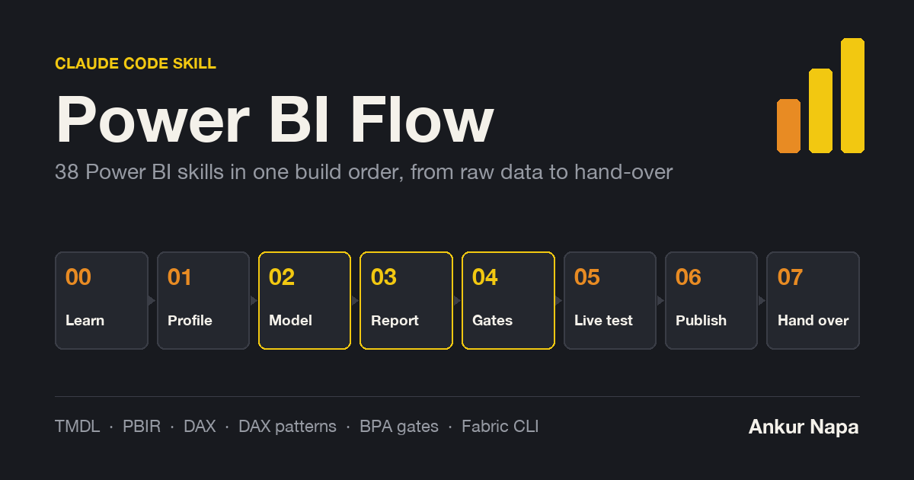

# Power BI Flow



A Claude Code skill that turns 38 separate Power BI skills into one build order. You hand Claude a client data dump with a KPI dictionary. The flow takes it through profiling, a TMDL model, a PBIR report, automated gates, a live test in Power BI Desktop, publishing and a clean hand-over.

Power BI Flow is a router. It holds no generators of its own. At each stage it tells Claude which skill to load, which machine the step needs and which gate must pass before moving on.

## Why it exists

Each Power BI skill is good at one thing: TMDL syntax, PBIR JSON, DAX, Best Practice Analyzer rules, the Fabric CLI. Left alone, Claude picks one by keyword and misses the rest. That is how a model ships with a broken relationship or a report ships with clipped card text.

This skill fixes the order. Learning comes before modelling. Gates come before Desktop opens. Every mistake goes into a build error log, which the next build reads first. Each dashboard gets a little cheaper and a little safer than the one before.

## The eight stages

| # | Stage | What happens | Skills loaded | Runs on |
|---|---|---|---|---|
| 0 | Learn | Read the error log's prevention checklist. Open the topic map for each DAX or model pattern in play. | `dax-modeling-guide`, the knowledge base | Mac |
| 1 | Profile | List every file with its row counts, keys, date ranges and data cut-off. Read the KPI dictionary. Note the expected figures for later reconciliation. | `pbi-dashboard-flow`, `semantic-models:power-query` | Mac |
| 2 | Model | Generate dims, facts, relationships, a date table and measures in display folders as TMDL. | `pbi-dashboard-flow`, `pbip:tmdl`, `semantic-models:dax`, `semantic-models:standardize-naming-conventions`, `power-bi-security` | Mac |
| 3 | Report | Generate pages and visuals as PBIR JSON. Size every textbox from its text. Write a phone layout for every visual. | `pbi-dashboard-flow`, `pbip:pbir-format`, `reports:pbi-report-design`, `reports:create-pbi-report`, `reports:modifying-theme-json`, `reports:svg-visuals`, `reports:deneb-visuals` | Mac |
| 4 | Gates | Check references, lint TMDL, lint layout, map empty space, run the Best Practice Analyzer, review model and report. | `pbi-dashboard-flow`, `tabular-editor:bpa-rules`, `semantic-models:review-semantic-model`, `reports:review-report`, `semantic-models:lineage-analysis` | Mac (BPA needs Windows) |
| 5 | Live test | Open the project, refresh, reconcile every headline number with DAX, time every visual on a cold cache, screenshot desktop and phone pages. | `pbi-desktop:connect-pbid`, `semantic-models:refreshing-semantic-model`, `power-bi-dax`, `power-bi-diagnostics`, `tabular-editor:te2-cli`, `tabular-editor:c-sharp-scripting` | Windows |
| 6 | Publish | Push to the Power BI service or Fabric. Export TMDL for version control. Tune capacity and security. | `fabric-cli:fabric-cli`, `power-bi-deployment`, `fabric-senior-dev`, `fabric-pbi-perf-remediate`, `fabric-pbi-security-remediate` | Mac or Windows |
| 7 | Hand over | Write the data dictionary. List assumed targets and data quirks. Append each new mistake to the error log with a prevention rule. | `power-bi-docs`, `tabular-editor:te-docs`, `pbi-dashboard-flow` | Mac |

## Mac or Windows

Power BI Desktop, Tabular Editor 2, DAX Studio and pbi-cli only run on Windows. The flow is built around that:

- **On a Mac** you can do stages 0 to 4 plus stage 6. Profiling, generating the model and report, every Python gate and publishing through `fab` all work from files.
- **On Windows** you also get stage 5: refresh, live DAX, Best Practice Analyzer runs, performance timing and the visual check in Desktop.

A typical split is to build and gate on the Mac, then open the finished project once on Windows for the live test.

## Gates

No stage moves on until its gate reports 0 fail.

| Gate | Catches |
|---|---|
| `check_refs.py` | Visuals bound to a table, column or measure that does not exist |
| `tmdl_lint.py` | Spaces instead of tabs, misplaced `///` descriptions, measures without descriptions, IDs that would sum |
| `layout_lint.py` | Text that will not fit its box, table headers too tight for their column, visuals off the phone canvas |
| `layout_map.py` | Large empty areas on a page |
| `external_checks.py` | PBIR schema errors, overlapping visuals, Best Practice Analyzer rules that got worse since the baseline |
| `perf_check.py` | Any visual slower than 1,500 ms on a cold cache |

These tools ship with `pbi-dashboard-flow`.

## Small jobs

Not every task needs all eight stages.

| Job | Stages |
|---|---|
| One new measure | 0, 2, 4, 5 |
| One new visual | 3, 4 |
| Review an existing model | 4 |
| Speed up a slow report | 5, 6 |
| Publish a finished project | 6 |

The pbi-cli skills (`power-bi-modeling`, `power-bi-pages`, `power-bi-visuals`, `power-bi-filters`, `power-bi-themes`) edit a live model or report in place. They suit quick fixes on Windows. For a full build the flow prefers the generators in `pbi-dashboard-flow`, because they rebuild everything from source each time.

## Rules that travel with every build

1. Generate with Desktop closed. Its save prompt writes its in-memory copy over the generated files.
2. No stage moves on until its gate shows 0 fail.
3. Every headline number reconciles against the source or the answer key.
4. Client data never leaves the client folder. A demo uses a fictional copy built by the steps in `pbi-dashboard-flow`.

## Install

**1. This skill**

```bash
git clone https://github.com/AnkurNapa/power-bi-flow ~/.claude/skills/power-bi-flow
```

**2. The marketplace plugins** from [data-goblin/power-bi-agentic-development](https://github.com/data-goblin/power-bi-agentic-development). In Claude Code:

```
/plugin marketplace add data-goblin/power-bi-agentic-development
/plugin install pbip@power-bi-agentic-development
/plugin install pbi-desktop@power-bi-agentic-development
/plugin install reports@power-bi-agentic-development
/plugin install semantic-models@power-bi-agentic-development
/plugin install tabular-editor@power-bi-agentic-development
/plugin install fabric-cli@power-bi-agentic-development
```

The `pbip` plugin adds hooks that validate TMDL and PBIR files after every edit.

**3. pbi-cli** (Windows only), used by the `power-bi-*` skills:

```bash
pipx install pbi-cli-tool
```

**4. The build skill and knowledge base.** `pbi-dashboard-flow`, `dax-modeling-guide` and the `power-bi-*` skills live in `~/.claude/skills/`. The knowledge base (DAX and modelling study notes, topic maps, dashboard design playbooks and the build error log) is private and not part of this repo. Without it, stages 0 and 7 fall back to the plugin skills alone.

**5. Windows tools** for stage 5: Power BI Desktop, Tabular Editor 2, DAX Studio and optionally pbi-tools, ALM Toolkit, Measure Killer and Bravo.

## Using it

Ask Claude for any Power BI job in plain words. For example:

- "Build a Power BI dashboard from this data dump and KPI dictionary."
- "Add a rolling 13 week OEE measure to the packaging model."
- "Review this semantic model before I hand it over."
- "Publish the Northgate project to the client workspace."

The skill triggers on Power BI work, names the stage it is starting with and loads the skills that stage needs.

## Repo layout

```
power-bi-flow/
├── SKILL.md            the router Claude reads
├── README.md           this file
└── assets/
    └── og-image.png    social preview, 1200 x 630
```

## Credits

- PBIP, report, semantic model, Tabular Editor, Desktop and Fabric CLI skills: [Kurt Buhler, data-goblins](https://github.com/data-goblin/power-bi-agentic-development), GPL 3.0
- Live model and report editing: pbi-cli

## Author

Ankur Napa
